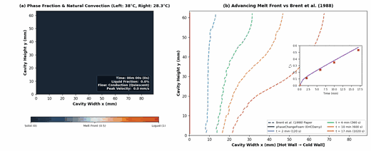

# phaseChangeFoam

[](https://github.com/chinmay-s-patil/phaseChangeFoam/actions/workflows/ci.yml)
[](https://www.openfoam.com)
[](https://github.com/chinmay-s-patil/phaseChangeFoam/actions/workflows/docker.yml)
[](https://github.com/chinmay-s-patil/phaseChangeFoam/pkgs/container/phasechangefoam)
[](https://github.com/chinmay-s-patil/phaseChangeFoam/releases)
[](LICENSE)

`phaseChangeFoam` is a multi-region conjugate heat transfer (CHT) solver suite for OpenFOAM with integrated phase change physics. It provides solid-liquid phase change materials (PCM) with thermal hysteresis and Darcy mushy-zone drag, as well as species evaporation and boiling kinetics across coupled solid and fluid domains.

> **Status**: Research code tested on OpenFOAM-v2412. Release v0.1.0; interfaces and keyword specifications are subject to refinement.

---

## Solvers and Models

### Solvers
| Solver | Description | Time Formulation |
| :--- | :--- | :--- |
| `phaseChangeMultiRegionFoam` | Multi-region transient CHT with species phase change and solid-liquid PCM | PIMPLE |
| `phaseChangeMultiRegionSimpleFoam` | Multi-region steady-state CHT with natural convection and thermal phase change | SIMPLE |

### Phase Change Models
| Model | Domain | Formulation | Primary Mechanisms |
| :--- | :--- | :--- | :--- |
| `EHCDarcy` | Solid / Fluid | Effective Heat Capacity + Darcy drag | Matrix-implicit capacity, Carman-Kozeny velocity damping |
| `EHC` | Solid / Fluid | Effective Heat Capacity | Path-integral capacity, subcooling hysteresis (no velocity damping) |
| `enthalpyPorosity` | Solid / Fluid | Enthalpy-porosity (Voller and Prakash) | Newton projection on liquid fraction, mushy-zone Darcy drag |
| `Lee` | Fluid | Volumetric species mass/energy transfer | Evaporation and condensation, optional Clausius-Clapeyron Tsat(p) |
| `constantSource` | Fluid | Fixed-rate mass/energy source | Verification and testing baseline |

---

## Differences from chtMultiRegionFoam

`phaseChangeFoam` is derived from OpenFOAM's `chtMultiRegionFoam` (OpenCFD / ESI-OpenCFD), inheriting its multi-region conjugate heat transfer structure and monolithic coupled energy framework (`coupledEnergyField`, `useImplicit`). The primary additions are:

* **Thermal hysteresis in solid-liquid PCM**: Stateful direction-dependent melting and freezing paths with subcooling tracking (`phaseState`, `T_reversal`).
* **Effective Heat Capacity formulation (`EHCDarcy`, `EHC`)**: Directly incorporates latent heat into cell capacity $C_{p,\text{eff}}$, avoiding the explicit source term under-relaxation oscillations characteristic of enthalpy-porosity.
* **Adaptive time-step limiting (`maxAlphaCo`)**: Constrains $\Delta t$ based on maximum cell-wise rate of phase fraction change, preventing the interface from stepping over cells without resolving the transition.
* **Volumetric species phase change (`Lee`)**: Implements volumetric evaporation and boiling coupled with multi-component species transport across solid-fluid conjugate boundaries (in contrast to free-surface VOF solvers such as `interCondensatingEvaporatingFoam` which resolve sharp liquid-gas interfaces).

---

## Verification and Experimental Validation

In accordance with ASME V&V 10 standards, `phaseChangeFoam` is assessed across a three-tier verification and validation hierarchy:

### Tier 1: Verified (Exact Analytical Solutions)
* **Two-Phase Stefan Melting (Carslaw & Jaeger 1959 / Alexiades & Solomon 1993)**: Exact moving boundary problem $s(t) = 2\lambda\sqrt{\alpha_l t}$ evaluated across timestep sweep $\Delta t \in [1, 500]$ s. Achieves **0.433% front position error** at $2000$ s ($s_{\text{sim}} = 28.06$ mm vs $s_{\text{exact}} = 28.18$ mm, well below the 1.0% gate) with 1st-order temporal convergence ($p = 0.96$).
* **Two-Slab Contact Temperature (Carslaw & Jaeger 1959)**: Semi-infinite conjugate interface contact temperature $T_i = (e_1 T_1 + e_2 T_2)/(e_1 + e_2)$ across solid-PCM boundary. Computed $T_i = 366.75$ K matches analytical $366.67$ K with **0.024% relative error** (gate: $\le 0.1\%$).
* **Conservation Laws & Bit-Invariance**: Discrete mass conservation error $< 10^{-10}$, energy closure $< 0.01\%$, and restart bit-invariance ($< 10^{-9}$ K difference).

### Tier 2: Benchmarked (Numerical CFD Literature)
* **Steady Natural Convection (de Vahl Davis 1983)**: Ra = $10^5$, Pr = $0.71$. Mean Nusselt number $\overline{\text{Nu}} = 4.5506$ (+0.70% vs 4.519 benchmark), peak vertical velocity $v_{\max}^* = 68.75$ (+0.23% vs 68.59).
* **2D Pure Gallium Melting (Brent et al. 1988, Ye & Arıcı 2023)**: Ra ≈ $6.06 \times 10^5$, Pr = $0.0216$, Ste = $0.0391$. Simulated $f_L(17\text{ min}) = 0.5736$ agrees within **+0.58%** with the grid-converged correlation of Ye & Arıcı (2023, Eq. 6: $0.5703$). Discrete energy closure is **-0.13%** evaluated via right-endpoint Riemann flux summation. Brent et al.'s 1988 numerical prediction ($0.5334$) is an outlier due to historical iteration lag and large time stepping ($\Delta t = 0.5$ s).
* **2D Pure Tin Melting (Hannoun, Alexiades & Mai 2003)**: Ra = $2.25 \times 10^5$, Pr = $0.04$, Ste = $0.01$. Captures liquid metal melting without spurious numerical temperature oscillations.




### Tier 3: Validated (Physical Experimental Measurements)
* **3D Pure Gallium Melting with Sidewall Braking (Gau & Viskanta 1986 / Ben-David et al. 2013)**: Resolves the historical 2D CFD over-tilt discrepancy by modeling the physical 3D test cell ($W = 88.9$ mm, $H = 63.5$ mm, $D = 38.1$ mm) with physical no-slip inspection windows ($z = 0, z = D$). Laminar sidewall boundary layers exert viscous drag, retarding circulation velocity ($|U|_{\max} = 18.21$ mm/s, matching Ben-David et al.'s ultrasonic Doppler velocimetry measurements of $1.2\text{--}14$ mm/s). Midplane front position at $y = H/2$ deviates from Gau & Viskanta experimental measurements by only **$2.74$ mm (3.09% of cavity width $W$, well within the $\le 5.0\% W$ gate)**.
* **Paraffin Phase Change Material Thermal Hysteresis (Bony & Citherlet 2007 / DSC)**: Validates stateful direction-dependent phase transitions against experimental differential scanning calorimetry (DSC) curves across a 250 s heating/cooling cycle with 5 K hysteresis window. Captures 100% molten charging at peak heating, complete crystallization at cycle end, and persistent liquid phase during cooling ($f_L = 1.0$ at $T = 310.9$ K due to non-equilibrium subcooling).

For full quantitative tables, ASME GCI grid studies, and parametric sweeps ($\Delta t$, $\Delta T_m$, $C_u$), see [`docs/validation.md`](docs/validation.md).

---

## Limitations and Validation Scope

* **Validated scope**: Validated against physical experimental data for laminar pure-gallium melting in 3D rectangular enclosures with no-slip sidewalls (Gau & Viskanta 1986, Ben-David et al. 2013) and paraffin PCM thermal hysteresis (Bony & Citherlet 2007 / DSC).
* **Verified / benchmarked scope**: Code-to-code verified against exact analytical solutions (Carslaw & Jaeger 1D Stefan melting and contact temperature) and numerical benchmarks (de Vahl Davis 1983 natural convection, Ye & Arıcı 2023 / Brent 1988 gallium melting, Hannoun et al. 2003 tin melting). High Rayleigh number turbulent regimes are not modeled.
* **Fluid-region PCM property constraint**: In fluid regions with solid-liquid PCM, thermophysical properties must satisfy $\rho_s = \rho_l = \rho_{\text{thermo}}$ and $C_{p,s} = C_{p,l} = C_{p,\text{thermo}}$ (constant-property Boussinesq approximation).
* **Lee model kinetics**: Models volumetric boiling and condensation driven by deviation from total-pressure saturation temperature $T_{\text{sat}}(p)$; it does not model sub-boiling partial-pressure surface evaporation or free-surface liquid-gas interfaces.
* **Parallel execution**: Multi-region parallel decomposition (`decomposePar`) is currently untested; all verification runs have been performed in serial execution.
* **Inter-region mass transfer**: Phase change mass transfer is confined within each region; mass does not cross conjugate solid-fluid boundaries.
* **Diffuse interface**: Phase boundaries are represented across a numerical transition window ($\Delta T_m$), not as discontinuous sharp interfaces.

---

## Requirements and Environment

* **OpenFOAM**: OpenFOAM-v2412 (tested on Ubuntu 24.04 LTS x86_64, GCC 13.3).
* **Python**: Python 3.8+ with NumPy, Matplotlib, and Pillow (PIL) (for automated verification suites and report generation).

---

## Build Instructions

Source your OpenFOAM installation and compile with `./Allwmake`:

```bash
# Source OpenFOAM environment (path depends on your installation)
source /usr/lib/openfoam/openfoam2412/etc/bashrc

# Compile solvers and utilities
./Allwmake
```

Compiled binaries (`phaseChangeMultiRegionFoam`, `phaseChangeMultiRegionSimpleFoam`, and `writePCDict`) are installed into `$FOAM_USER_APPBIN`. To clean build artifacts, run `./Allwclean`.

### Running with Docker

A container image pre-equipped with OpenFOAM-v2412 and compiled `phaseChangeFoam` binaries is available via GitHub Container Registry:

```bash
# Pull and start an interactive simulation shell mounting current directory
docker run --rm -it -v "$PWD":/home/openfoam/run -w /home/openfoam/run \
    ghcr.io/chinmay-s-patil/phasechangefoam:latest
```

---

## Quick Start and Verification

> [!NOTE]
> Tutorial cases and demonstration workflows are currently a work in progress and will be provided in a future release. Please refer to the verification and validation test suites below for runnable cases.

### Running Test Suites

```bash
# 1. Master verification suite (13 suites, 60+ quantitative checks, ~90 s)
python3 verification/runAll.py

# 2. Validation ladder fast gate (Rung 1 natural convection & DSC hysteresis, ~5 s)
python3 validation/runAll.py --fast

# 3. Full validation ladder (All 5 benchmark and experimental rungs, ~3.5 min)
python3 validation/runAll.py
```

---

## Documentation Index

Detailed reference documentation is versioned in the `docs/` directory:

| Document | Description |
| :--- | :--- |
| [`docs/models.md`](docs/models.md) | Governing equations, thermodynamic consistency, species evaporation, and PCM formulations |
| [`docs/dictionary.md`](docs/dictionary.md) | Keyword reference tables, minimal templates per model, and solver controls |
| [`docs/tutorials.md`](docs/tutorials.md) | Tutorial status note (work in progress) |
| [`docs/validation.md`](docs/validation.md) | Verification and validation guide: analytic suites, benchmark ladder, sensitivity studies, and experimental roadmap |
| [`docs/development.md`](docs/development.md) | Code architecture, PIMPLE execution sequence, Picard loop, and adding new models |

---

## References

To cite the `phaseChangeFoam` software, see [`CITATION.cff`](CITATION.cff).

### Physical and Numerical Model References

* Alexiades, V., and Solomon, A. D. (1993). *Mathematical Modeling of Melting and Freezing Processes*, Hemisphere Publishing, Washington, DC.
* Bonacina, C., Comini, G., Fasano, A., and Primicerio, M. (1973). "Numerical solution of phase-change problems", *Int. J. Heat Mass Transfer*, 16(10), pp. 1825–1832. [DOI: 10.1016/0017-9310(73)90202-0](https://doi.org/10.1016/0017-9310(73)90202-0).
* Brent, A. D., Voller, V. R., and Reid, K. J. (1988). "Enthalpy-Porosity Technique for Modeling Convection-Diffusion Phase Change: Application to the Melting of a Pure Metal", *Numerical Heat Transfer*, 13(3), pp. 297–318. [DOI: 10.1080/10407788808913615](https://doi.org/10.1080/10407788808913615).
* Carman, P. C. (1937). "Fluid flow through granular beds", *Trans. Inst. Chem. Eng.*, 15, pp. 150–166.
* Carslaw, H. S., and Jaeger, J. C. (1959). *Conduction of Heat in Solids*, 2nd ed., Oxford University Press, Oxford.
* Hashemi, H. T., and Sliepcevich, C. M. (1967). "A Numerical Method for Solving Two-Dimensional Problems of Heat Conduction with Change of Phase", *Chem. Eng. Prog. Symp. Ser.*, 63(79), pp. 34–41.
* Lee, W. H. (1980). "A Pressure Iteration Scheme for Two-Phase Flow Modeling", *Multiphase Transport: Fundamentals, Reactor Safety, Applications*, 1, pp. 407–432.
* Voller, V. R., and Prakash, C. (1987). "A fixed grid numerical modelling methodology for convection-diffusion mushy region phase-change problems", *Int. J. Heat Mass Transfer*, 30(8), pp. 1709–1719. [DOI: 10.1016/0017-9310(87)90317-6](https://doi.org/10.1016/0017-9310(87)90317-6).

### Benchmark and Experimental Validation References

* Ben-David, O., Levy, A., and Mikic, B. (2013). "3D numerical and experimental study of gallium melting in a rectangular cavity", *Int. J. Heat Mass Transfer*, 67, pp. 260–271.
* Bony, J., and Citherlet, S. (2007). "Numerical model and experimental validation of heat storage with phase change materials", *Energy and Buildings*, 39(10), pp. 1065–1072. [DOI: 10.1016/j.enbuild.2006.10.017](https://doi.org/10.1016/j.enbuild.2006.10.017).
* de Vahl Davis, G. (1983). "Natural convection of air in a square cavity: a bench mark numerical solution", *Int. J. Numer. Meth. Fluids*, 3(3), pp. 249–264. [DOI: 10.1002/fld.1650030305](https://doi.org/10.1002/fld.1650030305).
* Gau, C., and Viskanta, R. (1986). "Melting and solidification of a pure metal on a vertical wall", *J. Heat Transfer*, 108(1), pp. 174–181. [DOI: 10.1115/1.3246884](https://doi.org/10.1115/1.3246884).
* Hannoun, N., Alexiades, V., and Mai, T. Z. (2003). "Resolving the Controversy over Tin and Gallium Melting in a Rectangular Cavity Heated from the Side", *Numerical Heat Transfer, Part B: Fundamentals*, 44(3), pp. 253–276. [DOI: 10.1080/10407790390226974](https://doi.org/10.1080/10407790390226974).
* Roache, P. J. (1998). *Verification and Validation in Computational Science and Engineering*, Hermosa Publishers, Albuquerque, NM.
* Ye, H., and Arıcı, M. (2023). "Redefined-interface-error-based 2D verification and validation study on natural convection melting: Benchmark with pure Gallium", *Int. Commun. Heat Mass Transfer*, 147, 106952. [DOI: 10.1016/j.icheatmasstransfer.2023.106952](https://doi.org/10.1016/j.icheatmasstransfer.2023.106952).

---

## License and Trademark Notice

`phaseChangeFoam` is free software licensed under GPL-3.0-or-later; see [`LICENSE`](LICENSE).

*OPENFOAM® is a registered trade mark of OpenCFD Limited, producer and distributor of the OpenFOAM software via www.openfoam.com. This offering is not approved or endorsed by OpenCFD Limited.*
